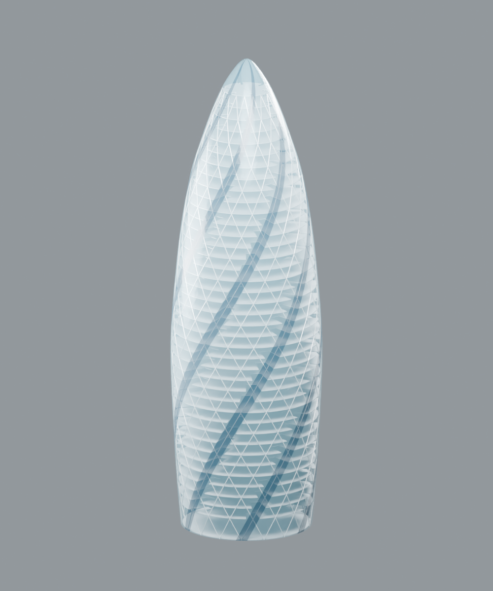

# Make your own Gherkin

Generate an editable, approximate model of London's Gherkin in **MicroStation or Blender**. The same small Python geometry library drives both versions: 40 slabs, six spiralling recesses, 720 diagrid members, and a triangulated glass facade with a closed crown.



I originally did this experiment with my own custom MicroStation MCP. That MCP remains private and is not included here. I converted the result into standalone scripts so you can have your own Gherkin. You do not need my MCP, an AI account, API keys, or any downloaded building assets to run them.

This is an independent experiment inspired by Bentley's Gherkin demonstration. The model reproduces our mathematical reconstruction, not Bentley's unpublished model or the building's as-built geometry. Read the [experiment notes](docs/EXPERIMENT.md) and [validation results](docs/VALIDATION.md) for the evidence and limits.

A separate [procedural interior version](interior/README.md) adds stairs, lifts, shaft openings, rooms, furniture and conceptual services in both applications. All interior placements are declared assumptions; no verified interior plans were supplied. The original scripts below remain unchanged.

## Choose your application

| Route | Requirements | Result |
| --- | --- | --- |
| Blender | Blender 4.5 LTS, tested on Windows | Native `.blend`, optional `.glb`, and three rendered views |
| MicroStation | Licensed MicroStation 2026 with its native Python support | Native 3D `.dgn` with solid floors, mesh framing and glazing |
| Geometry only | Python 3.10 or newer | Portable geometry JSON and regression tests |

Download this repository as a ZIP and extract it, or clone it. Keep `gherkin.py`, `parameters.json`, and your chosen adapter together. No `pip install` is needed. Other application versions and Blender on other operating systems have not been host-tested.

## Blender

From the extracted repository directory, run:

```sh
blender --background --python-exit-code 1 --python blender_gherkin.py -- --output-dir outputs/gherkin --render --glb
```

If `blender` is not on your PATH, use the path to your Blender executable. In PowerShell, put `&` before a quoted executable path. The output folder must not already exist; choose a new name for each run.

Open `outputs/gherkin/gherkin.blend` in Blender. The model is organized into four collections, with separate lights and a camera. Press Numpad 0 to see the prepared camera view. Optional `--render` writes `isometric.png`, `elevation.png`, and `cutaway.png`; the cutaway removes half the geometry temporarily for the image, while the saved model remains complete. Optional `--glb` exports the model for other viewers.

The script saves the model, reopens it, and validates the actual Blender meshes. To check it again in a new process:

```sh
blender --background --python-exit-code 1 --python blender_gherkin.py -- --verify outputs/gherkin/gherkin.blend --parameters outputs/gherkin/parameters.json
```

## MicroStation

1. Create and save a **new, empty, writable 3D DGN** using a 3D seed supplied with your MicroStation installation. Do not use an existing project model.
2. Open **Utilities → Python Editor**, open `microstation_gherkin.py` from this repository, and run it using the editor's Run button. This uses native Python scripting; Python Assistant is not required.
3. The script creates and saves 129 native elements, fits the views, and writes a sibling report folder named `<your-dgn-name>-gherkin-report`.
4. Close the DGN, reopen it, and run `verify_microstation.py` in Python Editor. Check that `reopened-validation.json` says `"passed": true`.

The script refuses a nonempty active model and refuses to overwrite an existing report folder. It saves checkpoints after at most 16 new elements, and at the floor, framing and glazing stage boundaries. If a run fails, keep its DGN and reports for diagnosis and start again with a fresh empty DGN. It does not delete or repair existing geometry.

The script converts metres to the active model's native units. Colors use the seed file's indexed color table; appearance can vary with your seed. Use a shaded or transparent display style to inspect the facade, and turn off the glazing levels to see the slabs. The Blender route provides the automated presentation renders.

The `MSPy*` modules are supplied by MicroStation and are only available inside it. Running this adapter with ordinary system Python will not work. No MicroStation binaries, seed files, SDK files, license configuration, or MCP components are distributed here.

## Parameters and evidence

The default [parameters.json](parameters.json) preserves the original experiment's dimensions exactly. [GEOMETRY_RECIPE.md](GEOMETRY_RECIPE.md) explains the equations and topology. [SOURCES.md](SOURCES.md) records the original research and its unresolved questions.

| Evidence class | Examples |
| --- | --- |
| Sourced building facts | 180 m height; six lightwells; the published 40-storey description |
| Public reconstruction conventions | 4.2 m teaching module and the rotational relationship used by earlier reconstruction studies |
| Explicit approximations in this experiment | Radius knots, exact slab schedule, recess dimensions, member sizes, offsets, crown sampling and glass opacity |

This is a visual geometry experiment. It does not establish structural, fire-safety, code-compliance, survey, or as-built accuracy. The diagrid stops at 168 m; the crown is a simplified facade cap. The glass surface has an intentionally open base.

For a variation, copy `parameters.json`. Blender accepts `--parameters path/to/your.json`; MicroStation reads the optional `GHERKIN_PARAMETERS` environment variable, or the file beside the script. Parameters remain bounded and internally validated. The regression fixture targets the supplied defaults, so a deliberate variation will not match the default-model tests.

## Outputs and tests

Each adapter produces the model, a parameter snapshot, stable logical IDs and native-object mapping, a timed event/error log, validation results, and actual native geometry read-back. Blender uses native object names; MicroStation maps stable logical IDs to its assigned element IDs. Copies of facade seam vertices between batches are intentional and retain their logical IDs.

Run the independent geometry regressions:

```sh
python -m unittest discover -s tests -v
```

They compare against geometry fingerprints, floor boundaries and volumes extracted from the original saved CAD model. They also check mesh closure, winding, seams, crown topology and member connectivity. Host verification is still necessary: passing these tests alone does not prove a DGN or Blender model was created.

To generate geometry JSON without a CAD application:

```sh
python gherkin.py --output outputs/geometry.json
```

## License

[The Unlicense](LICENSE) covers the original code, parameter specification, documentation and generated preview images in this repository. Linked articles, videos, trademarks and third-party applications retain their own rights and licenses. This project is not affiliated with or endorsed by Bentley Systems, the building's designers or its owners.
