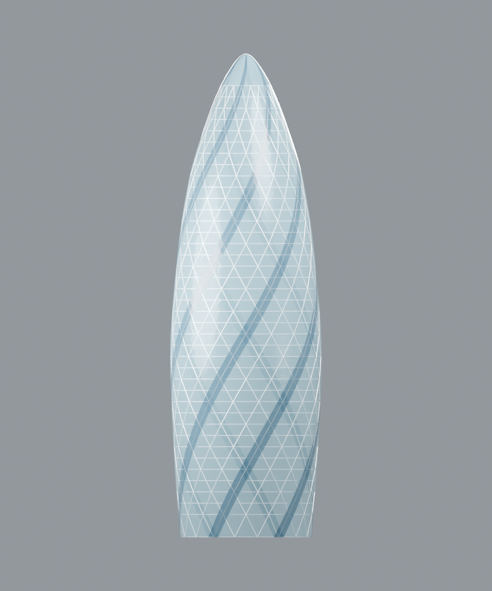
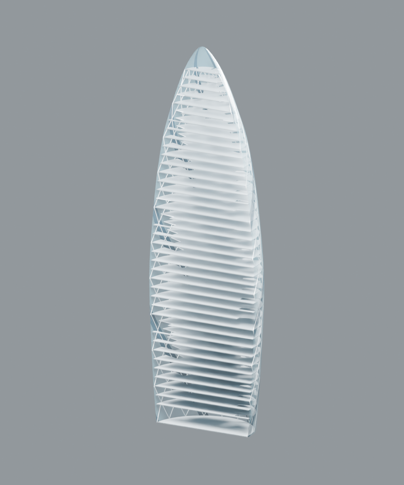

# Validation of the script conversion

Host tests were performed on Windows on 17 October 2026, using the supplied defaults. No custom MCP was used to execute either public adapter.

| Check | Result |
| --- | --- |
| Shared generator versus the original native CAD read-back | All 129 objects agree; maximum mesh coordinate difference 1.44 × 10⁻¹⁴ m |
| Geometry regressions | Eight tests pass, covering all original mesh fingerprints and floor boundaries/volumes, plus topology checks |
| MicroStation native creation and read-back | 129 elements; all 130 checks pass |
| MicroStation saved DGN reopened and checked | All 130 checks pass |
| Reopened native DGN versus original CAD regression fixture | All 129 objects agree; maximum floor volume difference 1.82 × 10⁻¹² m³ |
| MicroStation existing-model guard | Rerun rejected; saved DGN hash unchanged |
| Blender saved file reopened and checked | 129 meshes; all 131 checks pass |
| Blender verification in a separate process | Pass; maximum coordinate error 0.000007188 m |
| Blender invocation from another working directory, output path with spaces | Pass |
| Blender overwrite guard | Existing output directory rejected with nonzero exit status |
| Geometry-only CLI | Nested output path created successfully |

## Environments and replay timings

| Application | Version | Embedded Python | Measured script execution |
| --- | --- | --- | --- |
| MicroStation | 2026, 26.00.02.39 | 3.12.12 | 1.441 s to build, checkpoint, read back and fit views |
| Blender | 4.5.5 LTS, build 836beaaf597a | 3.11.11 | 32.242 s including save/reopen, read-back, GLB export and three CPU renders |

These are single prepared-script replay measurements on one machine, not performance guarantees. The timers start at entry to the scripts' main functions and include parameter loading and geometry generation. They exclude application startup, imports, code development and human interaction. MicroStation queues Save Settings after saving geometry; completion of that queued UI command is outside its script timer. A subsequent DGN reopen verified persistence. The earlier MCP experiment's longer timing and overrun are documented separately in [EXPERIMENT.md](EXPERIMENT.md).

MicroStation used a standard 3D metre seed with 10,000 units of resolution per metre. The adapter reads this conversion from the active model instead of hardcoding it. Other unit scales and customized seed color tables have not been host-tested. No application dependency was installed for these tests.

## What is read back

MicroStation resolves every saved element ID, checks its level and opacity, and retrieves the stored mesh vertices and triangle indices. For circular floors it queries the native solid's geometry, volume and range. For concave floors it facets the actual native ruled solid, checks its two profile boundaries, range and volume, and confirms that the native primitive represents a closed volume. The required native mesh coordinate tolerance is 0.000001 m.

Blender reopens the saved `.blend`, reads every mesh's transformed vertices and loop triangles, and checks topology, object identities, collection membership and material opacity. Closed floor and member meshes must have positive signed volume. The coordinate tolerance is 0.00002 m. Its seven circular slabs use 512-sided polygons; the largest circle-to-chord deviation is 0.000513821 m. Their small volume difference from analytic cylinders is intentional and tested.

The original-model regression fixture was extracted from actual CAD geometry rather than the generator's intended arrays. `tests/reference.json` preserves 89 mesh fingerprints and 40 floor records. Mesh fingerprints use coordinates quantized to integer micrometres and ordered topology; floor records retain boundary samples and volume. Raw MCP receipts and local paths were removed. This checks compatibility with our original reconstruction, not accuracy against the real building.

## Actual rendered geometry

The following images were rendered from Blender's reopened native model. The cutaway temporarily bisects the stored meshes at a plane; the saved full model is retained. PNG metadata was removed without changing the image pixels before publication.

| Elevation | Cutaway |
| --- | --- |
|  |  |

## Development failures and remaining limits

During conversion, MicroStation's Python modules required their dependency import order to be corrected. Its floor converter persisted recessed extrusions as ruled sweeps, so the validator was changed to inspect those actual solids rather than assume the original in-memory primitive type. A documented model-list constructor also proved unavailable; native view fitting was tested with the supported active-model argument. Those issues were resolved before the final clean run. Blender emitted an extension-cache permission warning in the restricted test environment, but completed the build, verification, export and renders successfully.

The GLB export completed, but has not been independently imported into another application and geometrically validated. Automated CI covers the pure geometry only; it does not substitute for the host tests above. Linux/macOS host execution, other Blender or MicroStation versions, custom seeds, and arbitrary edited parameter combinations are unverified. The model is not a structural analysis, a watertight whole-building solid, an as-built survey, or a recovered Bentley demo asset.
