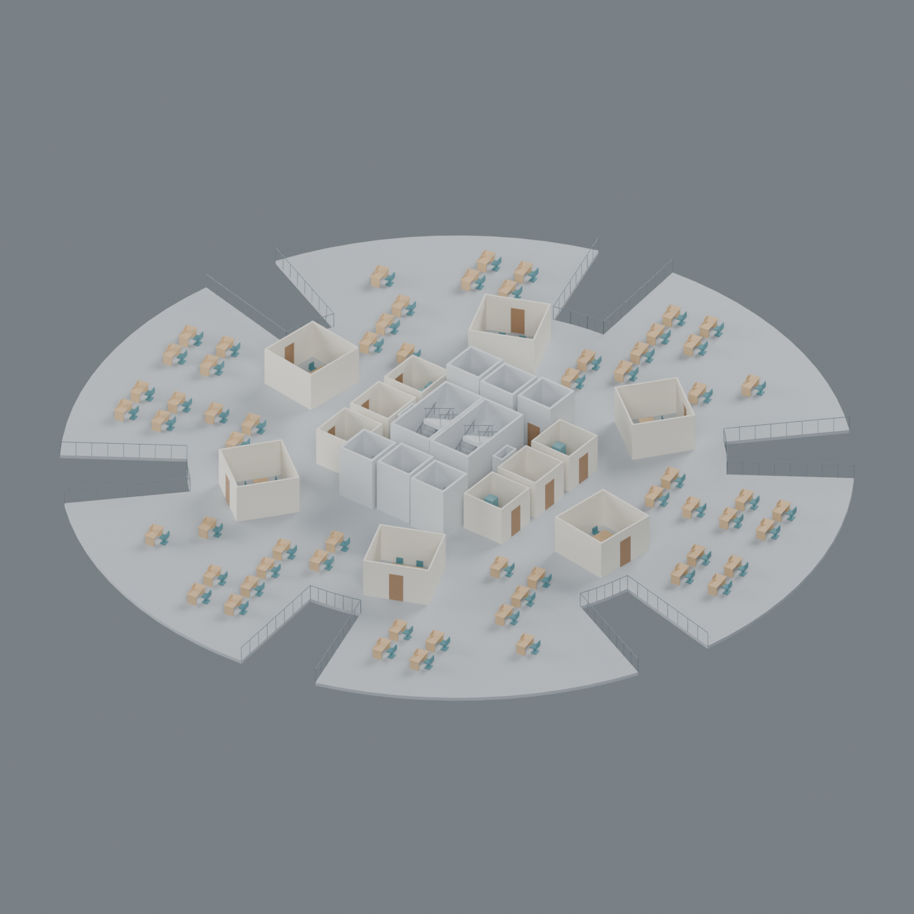

# Procedural interior experiment

This page describes the original conceptual interior preset (v1). For public-plan research, the revised core and electrical systems, use the separate [researched variant](../research/README.md). Both share the native adapters; `--variant researched` selects the newer parameters in Blender. The original preset remains the default.

This separate version adds a coordinated **conceptual interior** to the original approximate Gherkin. It generates shaft openings, stairs, lifts, rooms, doors, furniture, service equipment and connected pipe routes in both MicroStation and Blender.

**It does not reproduce the actual interior.** The supplied research contains no verified core plans, tenant layouts or service drawings. Every new interior placement and dimension is an explicit assumption. Geometry checks make the experiment more useful for developing a procedural building model; they do not make it engineering-grade, as-built or suitable for construction. See [EVIDENCE.md](EVIDENCE.md).

The original entry points and their default parameters remain unchanged. This version imports their geometry and native application helpers. Keep the complete repository together. It does not need the author's private MicroStation MCP, credentials, network access or additional Python packages. It uses the same [Unlicense](../LICENSE).



The image is an actual render of the generated L20 model. Its room and furniture layout is assumed. See the [floor plan](images/floor-plan.png), [services plan](images/services-plan.png) and [building cutaway](images/interior-cutaway.png).

## Run in Blender

From the repository root:

```sh
blender --background --python-exit-code 1 --python interior/blender_interior.py -- --output-dir outputs/interior-v1 --render
```

Use a new output folder for each run. `--render` writes a floor plan, furnished floor axonometric, services plan and building cutaway. `--capture-level 20` selects the model level for the first three images. `--glb` additionally exports geometry for other viewers. Blender 4.5 LTS is the tested host.

The saved `gherkin-interior.blend` contains the complete building. Captures temporarily hide or cut geometry; the saved model remains intact. Collections separate systems, and each mesh stores its model level, stage and component IDs. Geometry is batched to keep the model responsive; use `components.csv` or `object-mapping.json` to locate individual parts within a mesh.

To verify the saved model in a fresh process:

```sh
blender --background --python-exit-code 1 --python interior/blender_interior.py -- --verify outputs/interior-v1/gherkin-interior.blend --parameters outputs/interior-v1/parameters.json --exterior-parameters outputs/interior-v1/exterior-parameters.json
```

## Run in MicroStation

1. Create and save a new empty writable 3D DGN using your installed seed.
2. Open `interior/microstation_interior.py` in Utilities → Python Editor and run it.
3. Read the sibling `<dgn-name>-gherkin-interior-report` folder. Both `native-validation.json` and `design-validation.json` should say `"passed": true`.
4. Close and reopen the DGN, then run `interior/verify_microstation_interior.py`. Check both `reopened-*-validation.json` files.

MicroStation 2026 with native Python support is required. Units are read from the model. The adapter writes native mesh elements on separate system levels and saves at stage boundaries and after at most 64 new elements. It refuses an occupied model or existing report folder. Use a fresh empty DGN after a failed build; it never deletes or repairs existing work. A full generation and verification can take a few minutes; MicroStation's UI may be busy while its Python code runs.

Colors use your seed's indexed palette. Hide the glazing levels to inspect the interior. Blender supplies automated rendered views. The interior slabs, stairs, furniture and pipes are meshes in both applications; they are not MicroStation BIM objects or editable feature solids.

## Stages

| Stage | Generated content |
| --- | --- |
| 1 | Original facade and diagrid, perforated slabs, two stairs, landings, rails, shaft enclosures, six lift cars and conceptual core columns |
| 2 | Meeting rooms, washrooms, electrical/IT/janitor rooms, plant rooms and door openings |
| 3 | Desks, chairs, meeting tables, cafe furniture, washbasins, WC proxies and plant equipment proxies |
| 4 | Fire riser and sprinkler branches, hot/cold water risers and washbasin connections, drain riser |

Model labels `L01`–`L40` are indices into the original slab schedule, **not verified building floor numbers**. The omitted 4.2 m slab remains omitted; additional stair flights and intermediate landings cross the double-height entrance level. The concept's outer lifts stop at L37, its middle lifts at L39, and stairs reach L40. That arrangement is assumed, with step-free access to the final level unresolved.

Office furniture occupies L03–L35. L02 and L36 contain plant rooms; the other non-office levels receive cafe furniture where it fits. Rooms and furniture that violate the footprint or facade clearance are rejected and listed in `design-status.json`. Those rejected candidates are not missing as-built objects. The equipment is geometric representation, without manufacturers, capacity, fuel choice or connection specifications.

## Geometry and coordination

Slabs preserve the original outer polygons and 512-sided circular approximation. A scanline triangulation creates genuine rectangular shaft voids, shared vertices and closed side walls. It does not put stairs or lifts through solid floor plates.

Stairs have two 1.35 m flights, 12 rises per flight, 175 mm rises and 280 mm goings for the supplied 4.2 m module. These values are assumptions. Slab openings, stepped flights, landings and handrails are modeled explicitly. Vertical rays test tread support and headroom against mesh geometry.

Office placement reserves a central circulation zone, six radial aisle strips, room offsets and door approaches before adding workstation envelopes. Service routes follow a bounded orthogonal search grid that avoids stair and lift enclosures. Pipes leave service shafts above their low enclosures through deliberately open plenums. These openings have no fire-stopping design. Pipes use capped polygonal cylinders representing nominal outside dimensions, without hollow walls, elbows, fittings, hangers or insulation.

Native verification reads the saved application's actual mesh coordinates and triangles. Additional checks examine closed oriented meshes, slab volume and shaft openings, stair tread support/headroom, door approaches, disjoint furniture envelopes, sprinkler connectivity and intersections between different pipe systems. Checks have explicit scopes in their reports. They do not establish complete collision freedom or compliance.

## Parameters, reports and tests

`interior/parameters.json` contains interior assumptions. Blender accepts `--parameters`; MicroStation accepts the optional `GHERKIN_INTERIOR_PARAMETERS` environment variable. Both use the root exterior parameters unless explicitly supplied otherwise. V1 retains the original 40-level, 4.2 m module arrangement and fixed service roots at x = ±4 m on a 0.5 m routing grid. Changing settings can make a layout infeasible; validation must pass after every change. Only the supplied defaults have been tested in both applications.

Outputs include the native model, parameter snapshots, `rooms.csv`, `components.csv`, object/component mapping, a timed run/error log, design status, validation reports and actual native read-back compressed as `native-readback.json.gz`. Python's standard `gzip` module can read it. Reports and native files stay in your chosen output location.

```sh
python -m unittest discover -s tests -v
python interior/generator.py --output-dir outputs/interior-geometry
```

The first command tests both versions. The second generates portable geometry and schedules without either CAD host; it does not perform native verification. See [VALIDATION.md](VALIDATION.md) for the recorded host results and unresolved work.
