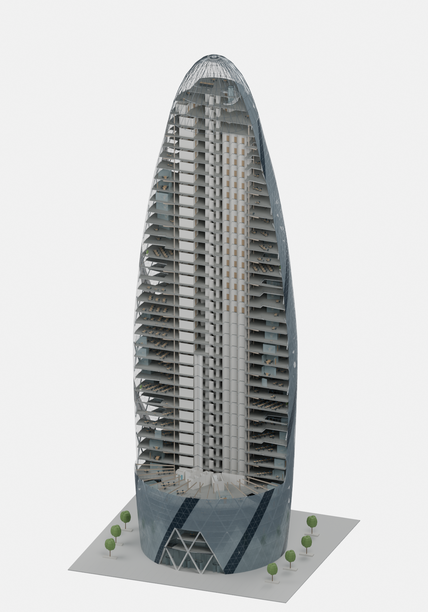
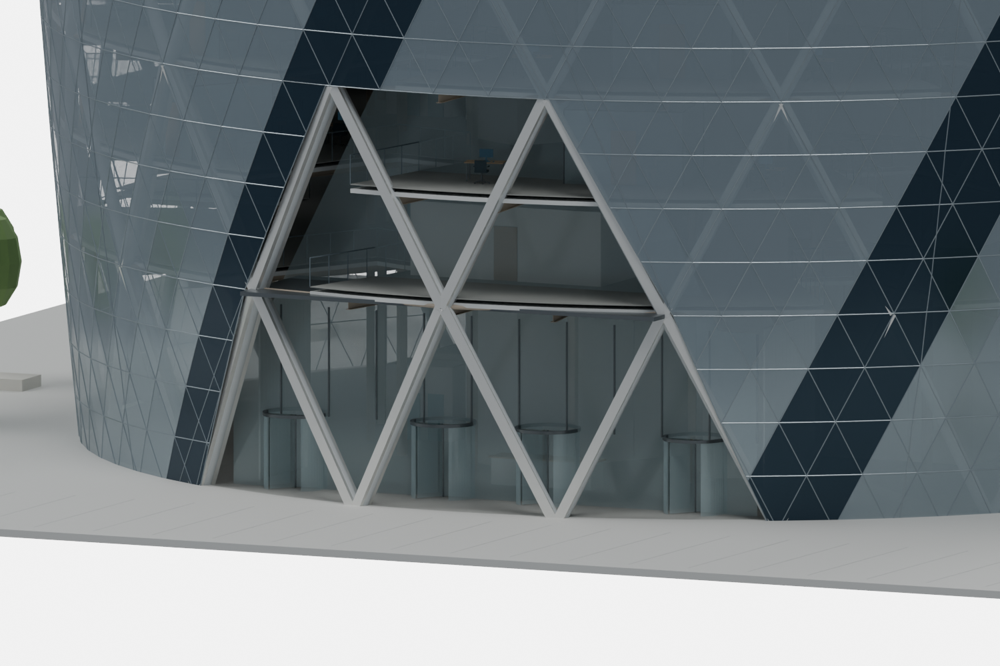
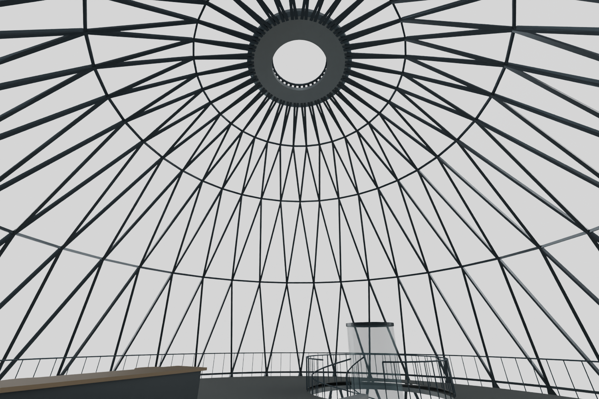
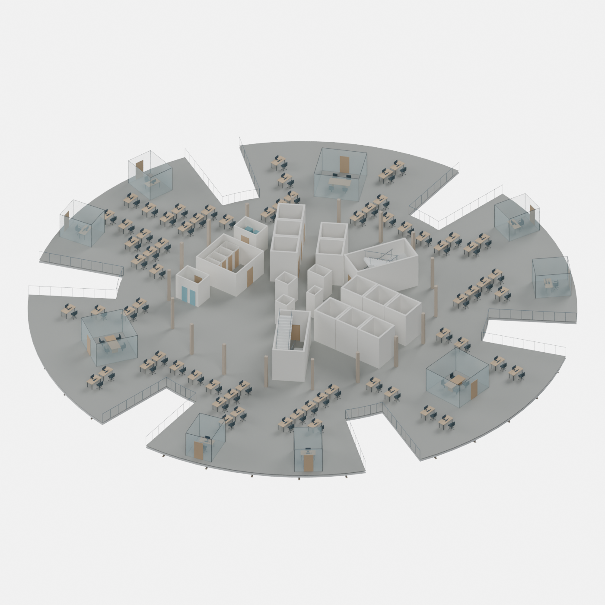

# Architectural detail preset

This separate v3 preset improves the entrance, crown, facade framing and furnished interiors. It builds on the researched core, stairs, lifts, plumbing and electrical networks. The original experiment and researched v2 remain selectable.

The target is the completed building's recognizable architectural form and a furnished cutaway informed by reference imagery. Operator plan diagrams inform the open Iris mezzanine, circular stair, small access-lift proxy and five private dining-room proxies. It is **not an engineering-approved or as-built model**. A geometric section matching a published dimension does not establish load capacity, fabrication details or actual location.



The cutaway exposes the procedural fit-out and structure. It is a render of the generated model, not a photograph or a recovered construction drawing.







## Run

Use Blender 5.2 from the repository root and choose a new output directory:

```sh
blender --background --python-exit-code 1 --python interior/blender_interior.py -- --variant architectural --output-dir outputs/architectural-v3 --capture-level 17 --render --glb
```

The command saves and reopens the native model, reads its meshes and checks them before rendering. Images include exterior isometric/elevation, entrance, crown interior, furnished floor, floor plan, electrical floor and architectural cutaway. The cutaway temporarily removes front geometry above an adjustable height; services are hidden for architectural views. The saved model retains all systems and their full geometry.

For MicroStation, create a new empty writable 3D DGN and run `interior/microstation_architectural.py` through Utilities → Python Editor. Close and reopen the DGN, then run `interior/verify_microstation_interior.py`. Blender produces the presentation renders. Both adapters consume the same bounded mesh recipe and component mappings; MicroStation's indexed palette depends on its seed.

For an independent Blender check:

```sh
blender --background --python-exit-code 1 --python interior/blender_interior.py -- --verify outputs/architectural-v3/gherkin-interior.blend --parameters outputs/architectural-v3/parameters.json --exterior-parameters outputs/architectural-v3/exterior-parameters.json
```

No assets, fonts, extra packages, private MCP server, credentials or network access are required to generate the model. The experiment began with the author's custom MicroStation MCP; the public scripts use the native application APIs directly.

## Verified build

Tested on Windows on 17 October 2026 in **Blender 5.2.1 LTS** and **MicroStation 2026, 26.00.02.39**. Each host saved 2,993 native meshes representing 104,936 components, including 2,020 workstations and 621 illustrative electrical circuits. All 64 design checks passed after reading actual native geometry. Blender also passed verification in a fresh process; MicroStation passed 2,994 native checks after the DGN was unloaded and reopened through its UI. All 47 Python regression tests passed.

The prepared Blender script took 311.85 seconds including generation, native creation, saving, read-back, GLB export and eight renders. MicroStation took 477.23 seconds including generation, native creation, checkpoint saves and validation. These measurements exclude application startup, imports, research, development and the additional independent verification. They are script replay measurements, not a repeat of the original 15-minute experiment. Blender 4.5 was not used for this preset.

The [portable validation summary](architectural-validation.json) records host versions, source fingerprints, measured errors, check scopes and omitted candidates. A passing check confirms its stated geometric condition; it does not establish that an inferred component matches the real building.

## Evidence and assumptions

See primary sources and conflicts in [EVIDENCE.md](EVIDENCE.md).

| Feature | Supported anchor | Reconstruction limit |
| --- | --- | --- |
| Envelope | 179.8 m top; 56.15 m maximum diameter; 30 m dome diameter and 22 m rise | Connecting profile, orientation and exceptional floor datums are inferred |
| Dome | 110 × 150 mm triangular member envelope; 2.4 m apex lens | Ring elevations, member count, plate thickness, joints, surround and lens curvature are inferred |
| Diagrid | Lower CHS 508 × 40 mm; upper CHS 273 × 12.5 mm | Intermediate sections interpolate; 24-sided hollow meshes have no engineered connections |
| Entrance | Four revolving doors; 7 m aluminium lobby panels; visible white chevrons | Door sizes/positions, leaf arrangement, portal extent and canopy dimensions are inferred |
| Interiors | Public-plan topology, floor-height anchors, open Iris mezzanine/circular stair and five private dining rooms | Mezzanine scale, main-stair termination, small bar lift, room rectangles and furnishings remain inferred |
| MEP | Documented system types, including four-pipe fan coils and DALI controls | Capacities, wiring ratings, hydraulics, exact routes and commissioning data are unavailable |

Facade triangles and explicit mullions are a computational subdivision, not a recovered schedule of installed triangular and diamond glass units. The ventilated double skin, blinds, operable vents, brackets and seals are not fabricated assemblies. The bar and five private dining rooms remain simplified proxies; a surveyed kitchen/restaurant arrangement is unavailable.

The inferred crown uses squared radius `225(1−t)(1+0.25t)`, where `t=(z−157.8)/22`. It retains the sourced 30 m base diameter and 22 m rise while giving a smoother taper. The 2.4 m lens terminates that surface. This connecting curve is a photo-informed modelling choice, not an equation supplied by the original engineers.

The highest floor has a clipped circular footprint and a genuine circular stair opening. A procedural curved stair connects model L39 to L40, with tread support/headroom checks. Transfer shuttles and main stairs end at model L39; a separate small glass lift proxy serves the bar. Exact setting-out and the actual fire/access strategy are unknown. Horizontal service routes avoid the inferred curved-stair zone.

The plaza has a continuous approach surface, stone seating planters and procedural trees. Its extent is illustrative. The entrance faces model −Y without a claimed compass bearing. Its facade opening is actually removed from the mesh. Revolving leaves are static proxies; accessible entrance and evacuation strategies have not been designed.

## Geometry and validation

`interior/architectural.py` extends the researched builder. `interior/architectural_geometry.py` creates closed hollow CHS, arbitrary-axis triangular/rectangular prisms, annuli and foliage. Convex clipping subtracts the inferred entrance volume from facade triangles. Solids have oriented faces and positive volume; open facade surfaces undergo native coordinate/topology comparison.

Workstations have separate worktops, frames, monitors, keyboards, mice, seats and caster bases. Meeting/private-office partitions use glass with explicit door openings. Furniture uses circulation and exclusion envelopes. Planting is rejected where it overlaps protected layout zones. These additions improve inspection and presentation without supplying missing tenant evidence.

Saved-model validation measures native vertices for crown sections, hollow-member walls, lobby panel height and lens diameter. It counts four door headers and tests five approach rays per door against facade and chevrons. These rays test a 1 m strip at torso height, not whole-body clearance, door operation or accessibility. Tests deliberately damage read-back lens geometry and obstruct the entry to demonstrate check failures.

Existing checks cover bounded batches, slab openings/volumes, stair headroom, furniture envelopes, sprinkler connectivity and selected electrical/wet-service intersections. They are scoped checks, not structural analysis, exhaustive multidisciplinary coordination, fire strategy, electrical design or construction approval.

Native validation also caught electrical routes crossing the new circular stair zone and two dining-room door approaches overlapping shuttle shafts during development. The final routing retains permanent exclusion zones, and the inferred room footprints clear those approaches. Regression tests cover both faults.

Parameters are in `interior/parameters-architectural.json` and `research/parameters-architectural-exterior.json`. Reports include component mappings, omitted candidates, host versions, timings and native read-back. Native files and raw consoles stay outside the public source release because they may contain application or machine metadata.

Third-party photographs and drawings are referenced, not redistributed. The Unlicense covers the repository's original code, reconstruction parameters and prose.
