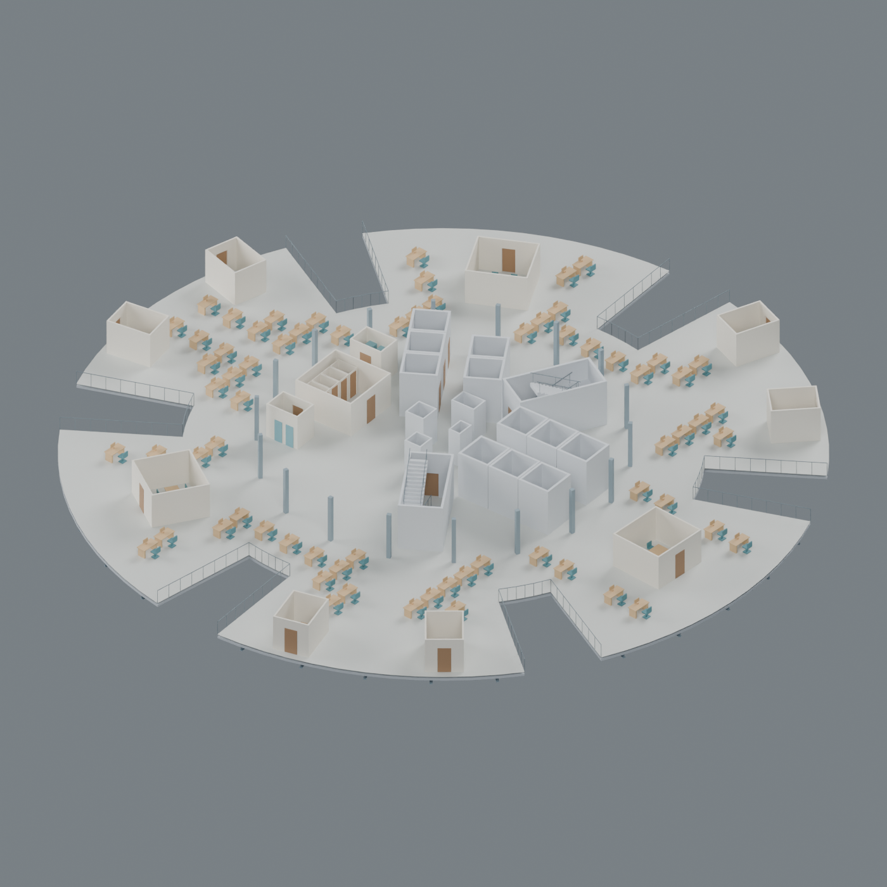
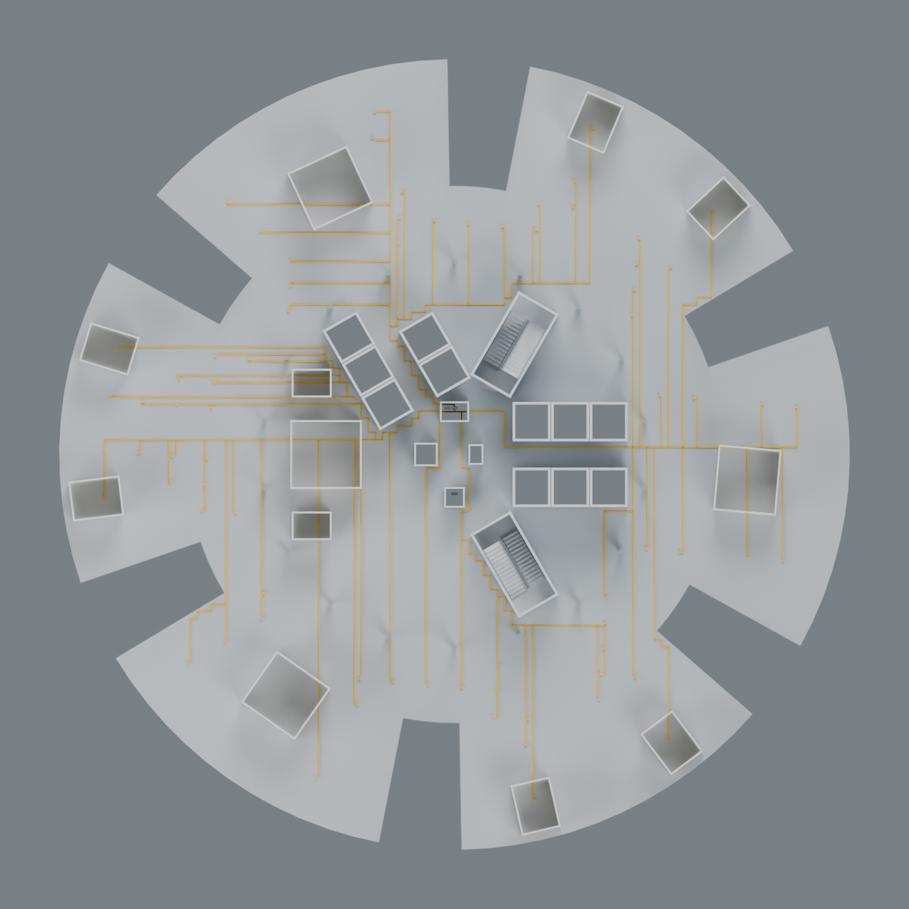
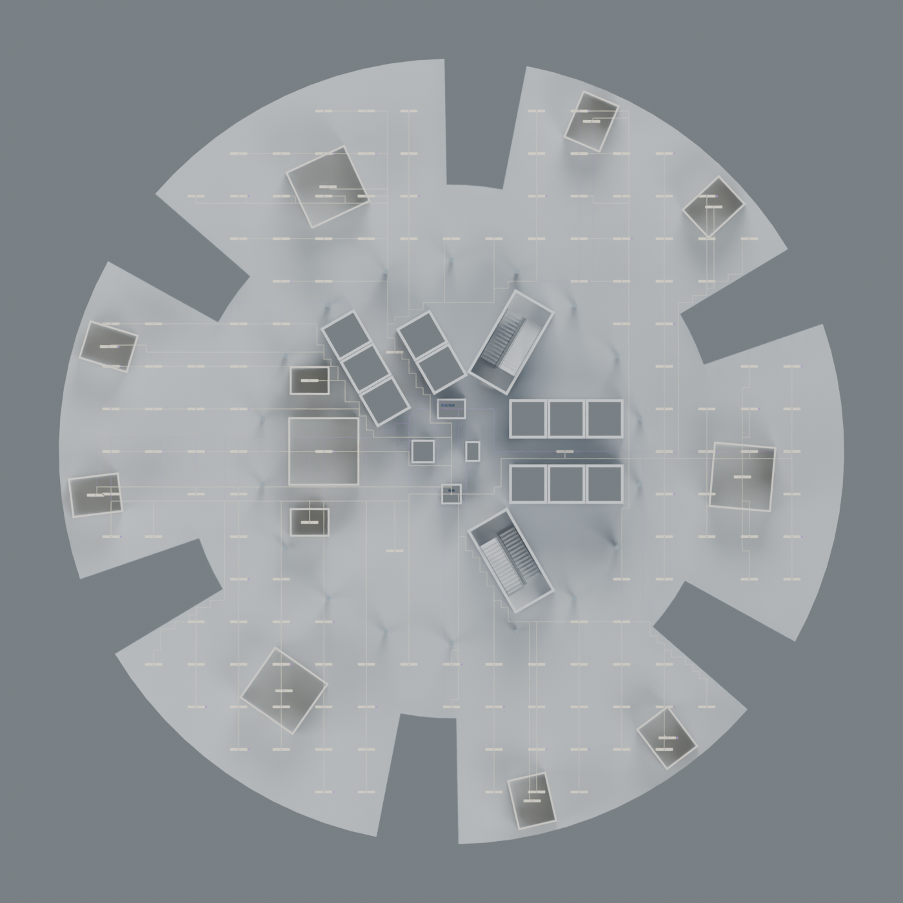

# Researched envelope and interior

This separate preset incorporates public plans and project-team engineering evidence. Read [EVIDENCE.md](EVIDENCE.md) for source links, conflicts and the boundary between documented facts and inferred geometry. The original demo and conceptual interior presets remain available.



The [geometry recipe](GEOMETRY_RECIPE.md) explains the procedural layout and routing. These images are renders of the saved native geometry. They depict an inferred fit-out, not a surveyed interior.

## Blender 5.2

Use Blender 5.2's executable explicitly if you also have an older Blender installed. Run from the repository root, choosing a fresh output folder:

```sh
blender --background --python-exit-code 1 --python interior/blender_interior.py -- --variant researched --output-dir outputs/researched-interior --capture-level 17 --render --glb
```

The script saves `gherkin-interior.blend`, reopens it, reads its native meshes and performs geometry/network checks. It saves at five stage boundaries. `--render` adds floor, furnished-floor, services, electrical power, electrical lighting and cutaway images. The cutaway is temporary; the saved model remains complete. Underfloor containment is exposed in the electrical power capture by hiding the raised panels.

To verify independently in another Blender process:

```sh
blender --background --python-exit-code 1 --python interior/blender_interior.py -- --verify outputs/researched-interior/gherkin-interior.blend --parameters outputs/researched-interior/parameters.json --exterior-parameters outputs/researched-interior/exterior-parameters.json
```

For the researched envelope without interiors:

```sh
blender --background --python-exit-code 1 --python blender_gherkin.py -- --parameters research/parameters-exterior.json --output-dir outputs/researched-envelope --render
```

No added packages, building assets, MCP server or AI service are required. These are native Python scripts using Blender's bundled API and the Python standard library.

## MicroStation

Create a new, empty, writable 3D DGN with an installed 3D seed. Open `interior/microstation_researched.py` in **Utilities → Python Editor** and run it. It uses the same researched geometry, writes native meshes in bounded batches and saves at most every 64 objects and at each stage transition. The sibling report folder must not already exist. Existing models are never cleared.

Close and reopen the saved DGN, then run `interior/verify_microstation_interior.py`. Both reopened validation reports must pass. Units come from the active model; there are no machine-specific paths in the public scripts. MicroStation's native Python modules are required; running this adapter in ordinary Python is unsupported.

## Model content

| Stage | Content |
| --- | --- |
| 1 | Researched envelope anchors, slabs with rotated shaft voids, raised floors, two stairs, radial lift-bank layout, assumed upper shuttles, steel core/floor/hoop/dome proxies |
| 2 | West WC blocks, service closets, meeting rooms, private offices and plant spaces |
| 3 | Procedural desks/chairs, meeting furniture, WC cubicles, basins, cafe and plant proxies |
| 4 | Sprinkler network, domestic water branches, drain riser, four-pipe fan-coil proxies with unconnected hydronic stubs |
| 5 | Two source risers, distribution boards, workstation floor outlets, underfloor containment, lighting circuits, DALI interface/controller proxies and occupancy/daylight sensor symbols |

Plan topology follows public evidence, but every interior coordinate and size remains inferred. Generated furniture is one plausible fit-out, not a copy of a current tenant. Disallowed candidates are recorded in `design-status.json`. Upper offices can use vacated lower-bank space; this is an explicit layout assumption. The two upper shuttles and repeated plant rooms are conceptual placements.

The 150 mm raised void and 2.75 m clear ceiling reference come from leasing information. The 30 mm floor panel is assumed. Ceiling finish panels are omitted for inspection. The 160 mm slab is a continuous proxy for documented composite construction. Member sizes, connections, exact dome framing and facade subdivisions are not fabrication data.

## Electrical scope

Electrical lines are connected geometric networks with stable component IDs and an exported circuit schedule. Source A serves the model's power circuits and source B its lighting circuits; this is an illustrative assignment, not the building's distribution topology or a redundancy design. DALI grouping is also illustrative. Sensor symbols do not include complete branch wiring.

The generator reserves separate service layers and avoids protected stair/lift enclosures and vertical wet-pipe drops. Actual saved conduit end-ring centroids are used to trace each outlet, luminaire and control interface back to its source. Circuit membership, wet-pipe intersection and floor-boundary checks complement that graph test. Tray geometry, all fittings, other trades and mandatory engineering separations are outside this limited test.

No load calculation, voltage, conductor rating, fault current, protection, earthing, emergency-power design, lux calculation or commissioning data is asserted. MEP and structure remain coordination illustrations. This is not construction-ready, code-compliant or as-built engineering documentation.

## Reports

Alongside the native model: both parameter snapshots, room/component CSV files, `electrical-circuits.csv`, `lift-schedule.json`, object/component mapping, native mesh read-back, validation, omissions and timed run/error logs. Every added part carries an evidence label. Reports identify checks that are limited or unverified.

```sh
python -m unittest discover -s tests -v
python interior/generator.py --variant researched --output-dir outputs/researched-geometry
```

The geometry-only command writes portable arrays and schedules; native CAD validation requires running an adapter. Recorded application results and release checks are in [VALIDATION.md](VALIDATION.md).

## Saved-model views

| Underfloor power routes | Lighting and control routes |
| --- | --- |
|  |  |

Plans show model L17. The assumed lower lift bank ends at L16, so this level shows fewer shafts than the lower typical core. Additional views: [floor plan](images/floor-plan.png), [services](images/services-plan.png), [interior cutaway](images/interior-cutaway.png), [researched envelope](images/envelope-isometric.png).
